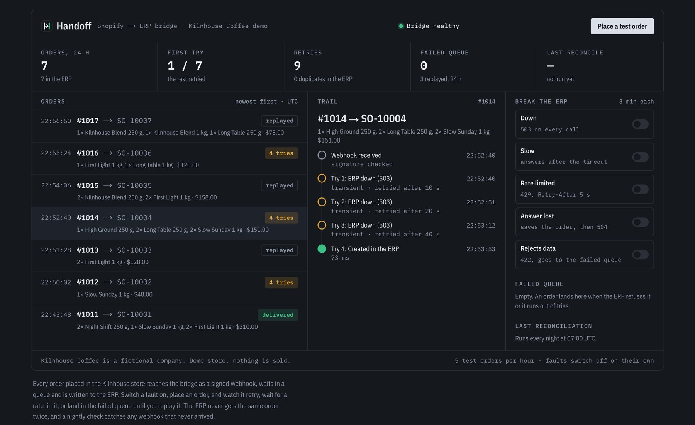
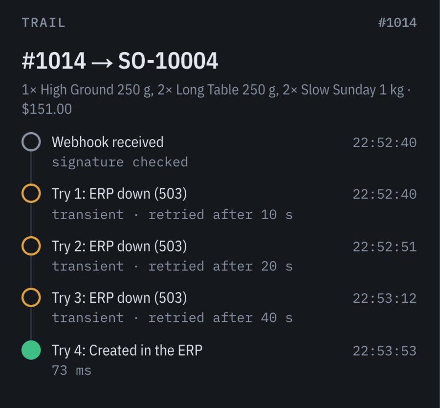
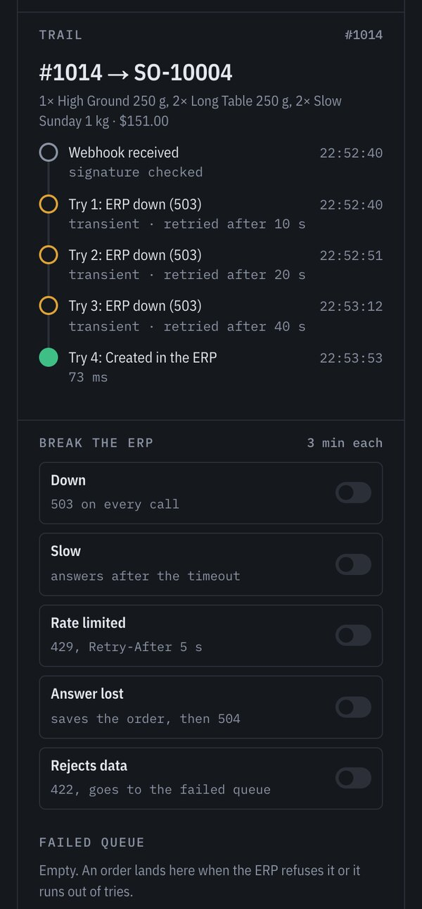

# Handoff

**An integration bridge between a Shopify store and an ERP, built to survive the ERP failing.**

Every order placed in the store arrives as a signed webhook, waits in a queue and is
written to the ERP exactly once. When the ERP is down, slow, rate limited or loses its
answer, the bridge retries with growing waits; when it refuses an order, the order goes
to a failed queue until someone replays it. Stock flows the other way, and a nightly
check catches any webhook that never arrived.

**Live:** [handoff.danielgcravo.com](https://handoff.danielgcravo.com), where you can
break the ERP yourself · [76-second walkthrough](https://handoff.danielgcravo.com/walkthrough.mp4)



The demo store is **Kilnhouse Coffee**, a fictional roaster: a real Shopify development
store with six coffees in two sizes. The ERP is fictional too, served by this app, with
its own item codes, no idempotency keys and a set of faults you can switch on.

## Try it

1. Under **Break the ERP**, switch **Down** on.
2. **Place a test order** and click it to follow its trail.
3. Watch each try fail with a 503 and the next one wait longer: 10 s, 20 s, 40 s…
4. Switch the fault off. The next try goes through, and the ERP has the order once.
5. Switch **Rejects data** on and place another order. It goes straight to the failed
   queue; switch the fault off and **Replay** it.

Visitors can place five test orders an hour, and faults switch themselves off after
three minutes.

## What it handles

| The ERP… | What the bridge does |
|---|---|
| is down (503) | Retries six times, 10 s to 5 min apart, then hands the order to the failed queue |
| is slow (answers after the timeout) | Gives up on the try after 8 s; the next try asks the ERP first whether the order arrived anyway |
| rate limits (429 + Retry-After) | Waits as long as the ERP asked before trying again |
| saves the order, then the answer is lost (504) | Finds the order on the next try instead of creating it twice |
| refuses the order (422) | Sends it to the failed queue at once: retrying cannot help |
| changes stock on its own | Pushes the new quantity to the store, minus orders still on their way to the ERP |

And on the store's side: a webhook delivered twice is acknowledged once; two webhooks for
the same order make one order; a webhook that never arrives is found by the nightly
reconciliation.

## Screenshots

| An order that needed four tries | On a phone |
|---|---|
|  |  |

## How it works

```
Shopify ──orders/create──▶ /api/webhooks/shopify ──▶ Postgres (bridge.orders)
 (webhook, HMAC)             verify, dedupe, store        │
                                                          ▼
                                QStash ──▶ /api/jobs/deliver ──HTTP──▶ ERP /erp/api/orders
                              (retries)    claim, look up, create        (fictional)
                                                          │
Shopify ◀──inventorySetQuantities── /api/jobs/stock ◀──HTTP── ERP /erp/api/stock?since=
                                     after each order and every 15 min

Schedules: sweep every 15 min · stock every 15 min · demo reset 06:45 UTC · reconcile 07:00 UTC
```

- **Webhook** (`src/app/api/webhooks/shopify`): checks the HMAC against the raw body,
  stores the order and answers at once; the ERP call happens later, so a slow ERP never
  looks like a failed webhook to Shopify.
- **Delivery** (`src/lib/bridge/deliver.ts`): claims the order so two tries never run
  together, asks the ERP whether it already has it, creates it if not, and records every
  try with its duration and outcome.
- **Classification** (`src/lib/bridge/classify.ts`): no answer, 408, 429 and 5xx are
  transient and retried; any other refusal, or a SKU with no mapping, is permanent.
- **Queue** (`src/lib/queue.ts`): QStash calls the delivery job until it answers 2xx. The
  job answers 503 to ask for another try and 200 once the order is delivered or in the
  failed queue, so the bridge, not the queue, decides when to stop.
- **Sweep** (`src/lib/bridge/sweep.ts`): re-queues orders the queue lost: never queued,
  stuck in a try that died, or waiting for a retry that never came.
- **Stock** (`src/lib/bridge/stock.ts`): the ERP has no webhooks, so the bridge polls it
  with a cursor and sets absolute quantities in the store. Units already sold but not yet
  booked in the ERP are subtracted first, so the store never sells them twice.
- **Reconciliation** (`src/lib/bridge/reconcile.ts`): every night, store orders of the
  last 48 hours that the bridge never received are taken in as if their webhook had
  come, and stock that drifted is corrected.

## Decisions

- **Idempotency at three levels.** The webhook ID stops redeliveries, the order ID stops
  two webhooks about one order, and a lookup in the ERP before every create stops the
  duplicate a lost answer would cause. The ERP's external reference is deliberately not
  unique, as in many real ERPs.
- **Absolute quantities only.** Sending "12 in stock" twice changes nothing; sending
  "minus 2" twice loses stock.
- **No personal data.** Test orders carry no customer, every order lands in the ERP under
  one account, and the demo's rate limits store a salted hash of the visitor's IP, never
  the address.
- **Store access behind an interface.** `Store` (`src/lib/shopify/store.ts`) is the only
  place that talks to Shopify's Admin API; the tests use an in-memory one.

## Stack

- **App:** Next.js 16 (App Router, Cache Components), React 19, TypeScript, Tailwind CSS 4.
- **Data:** PostgreSQL (Neon) with postgres.js and plain SQL migrations.
- **Delivery:** QStash (Upstash) for retries and schedules, Vercel for hosting.
- **Store:** Shopify Admin GraphQL API with the client-credentials grant (the token lasts
  24 hours and is renewed a minute early).
- **Tests:** Vitest, with integration tests against Postgres that switch on each ERP fault
  and check that no order is lost or duplicated.

## Running locally

```sh
docker compose up -d db                 # PostgreSQL on localhost:5434 (+ a test database)
npm install
cp .env.example .env.local              # fill in Shopify and QStash
npm run db:migrate && npm run db:seed   # schema and the Kilnhouse catalog
npm run dev                             # http://localhost:3002
npm test                                # unit and integration tests
```

Shopify and QStash need a public address to call back. In development, a tunnel works:

```sh
cloudflared tunnel --url http://localhost:3002   # set PUBLIC_URL to the address it prints
npm run shopify:webhooks -- "$PUBLIC_URL"        # point the store's webhook at it
npm run shopify:order                            # place a real test order
npm run fault -- down 2                          # or switch an ERP fault on for 2 minutes
```

Other scripts: `shopify:check` (token and scopes), `shopify:products` (load the catalog
into the store), `replay -- #1005`, `erp:adjust -- KH-ETH-250 20`,
`job -- stock|reconcile|sweep|reset`, `qstash:schedule`.

## Deploying

1. Create a Postgres database and run `npm run db:migrate` and `npm run db:seed` against
   it.
2. Create a Shopify app in the Dev Dashboard with custom distribution for your store and
   the scopes `read_products,write_products,read_inventory,write_inventory,read_locations,read_orders,write_orders`.
3. Deploy to Vercel with the variables in `.env.example`, `PUBLIC_URL` set to the site's
   address.
4. `npm run shopify:webhooks -- https://<site>` and
   `PUBLIC_URL=https://<site> npm run qstash:schedule`.

## License

MIT
